# ⚡ Awesome Cloud E-Commerce Hosting Platform

> **A curated showcase of premier enterprise SaaS platforms and self-hosted open-source digital commerce engines.**  
> *Architected for merchants, cloud DevOps engineers, CTOs, and headless commerce developers.*

  
  
  
  
  
  

**Last updated: October 2026** 🚀

---

## 📖 Table of Contents

- [🌐 Sector Overview & Market Dynamics](#-sector-overview--market-dynamics)
- [🏢 SaaS/Hosted Enterprise Platforms](#-saashosted-enterprise-platforms)
- [💻 Open-Source GitHub Projects](#-open-source-github-projects)
- [🤝 How to Contribute](#-how-to-contribute)
- [💖 Support & Sponsorship](#-support--sponsorship)
- [⚠️ Disclaimer](#️-disclaimer)
- [📈 Star History](#-star-history)

---

## 🌐 Sector Overview & Market Dynamics

The global e-commerce software and cloud hosting market is valued between **$7.1B–$10.5B in 2025** (projected to reach **$16.5B–$20B+ by 2030** at a **~12–20% CAGR**), powering a multi-trillion dollar digital commerce transaction ecosystem.

The sector exhibits a **moderately fragmented** structure characterized by distinct layers of consolidation:
- **Enterprise Tier (Concentrated / Oligopolistic):** Dominated by multi-billion dollar tech powerhouses (SAP, Shopify, Salesforce, Adobe) commanding mission-critical global retail and B2B digital sales.
- **Mid-Market & Headless/Composable Layer (Fragmented):** Highly fragmented across specialized MACH-certified composable architectures (commercetools, Spryker, Elastic Path) and modern self-hosted open-source backends (Medusa, Bagisto, Saleor, Spree) providing agility, zero GMV take rates, and infrastructure autonomy.

---

## 🏢 SaaS/Hosted Enterprise Platforms

| Product | Description | Company Size (Revenue / Valuation) | Pricing | Free Tier Limit |
| :--- | :--- | :--- | :--- | :--- |
| **[SAP Commerce Cloud](https://www.sap.com/products/crm/commerce-cloud.html)** | Enterprise commerce tightly integrated with SAP ERP and digital supply chain. | **~$250B+ Market Cap** (~$38B+ Annual Revenue) | **Starting ~$100,000/year** (annual license scaled by GMV bands) | **No free tier/trial**; 30-day trial license available via SAP Cloud Appliance Library (infrastructure compute billed separately by AWS/Azure/GCP). |
| **[Shopify Plus](https://www.shopify.com/plus)** | Enterprise tier of Shopify with native B2B, custom checkout scripting, and multi-store expansion. | **~$220B+ Market Cap** (~$8.5B+ Annual Revenue) | **$2,300/month** (3-year term) or **$2,500/month** (1-year term); variable % on GMV for high volume | **No free tier**; standard Shopify 3-day trial excludes Plus features, promotional 1–2 month evaluations available on request via sales for qualifying merchants. |
| **[Salesforce Commerce Cloud](https://www.salesforce.com/products/commerce-cloud/)** | Unified enterprise B2B and B2C commerce native to the Salesforce CRM and Data Cloud ecosystem. | **~$180B+ Market Cap** (~$35B+ Annual Revenue) | **B2B**: 1% GMV (Growth) / 2% GMV (Advanced); **B2C**: 1–3% GMV (min. enterprise commitments ~$100k+/year) | **No free tier/public trial**; On-Demand Sandboxes for partners/customers use usage-based credit consumption with Time-To-Live auto-termination. |
| **[Adobe Commerce Cloud (Magento)](https://business.adobe.com/products/magento/magento-commerce.html)** | Enterprise cloud commerce with AI merchandising (Adobe Sensei) and native Adobe Experience Cloud integrations. | **~$100B+ Market Cap** (~$24B+ Annual Revenue) | **Starting ~$40,000/year** on Cloud (GMV-tiered; on-premise starts ~$22,000/year) | **No cloud free tier/trial**; guided sales demo only (local sandbox testing available indefinitely via free open-source Magento Open Source). |
| **[commercetools](https://commercetools.com/)** | API-first, MACH-certified composable commerce platform powering headless architecture. | **~$1.9B Valuation** (~$150M+ ARR) | **Starting ~$40,000/year** (base SaaS platform license, scales by API volume/GMV) | **60-day free trial** with full core commerce API and Merchant Center access (excludes add-on frontend/inStore services; no credit card required). |
| **[BigCommerce Enterprise](https://www.bigcommerce.com/enterprise/)** | Open SaaS enterprise platform featuring native B2B portal tools and headless storefront connectors. | **~$400M Market Cap** (~$345M Annual Revenue) | **Starting $1,499/month** (Performance/Enterprise tier; self-serve base plans start at $29/month) | **15-day free trial** (unlimited access to core features including customer groups & abandoned cart; excludes custom domain linking and 301 redirects; no credit card required). |
| **[Spryker](https://spryker.com/)** | Composable B2B commerce and enterprise marketplace cloud engine. | **~$500M Valuation** (~$40M ARR) | **Starting ~$900,000/year** contract via AWS Marketplace listing (tailored mid-market licenses start ~$100k/year) | **No cloud free tier/trial**; sales-guided demo environments only (local demo shop available free for developers via open GitHub Docker SDK). |
| **[Shopware Cloud](https://www.shopware.com/)** | European commercial commerce platform with managed cloud hosting and spatial commerce tools. | **~$100M Funded** (~$80M Annual Revenue) | **Starting $600/month** (Rise plan; Evolve plan starts at $2,400/month) | **30-day free trial** of Shopware Cloud commercial features (open-source Community Edition is free forever for self-hosting). |
| **[Elastic Path](https://www.elasticpath.com/)** | Composable commerce platform specializing in family catalogs, multi-storefronts, and developer flexibility. | **~$110M+ Funded** (~$50M ARR) | **Starting $49,500/year** ($4,125/month billed annually for up to 15,000 orders or $5M GMV) | **6-week (42-day) trial store** environment available upon guided developer/sales request. |
| **[OroCommerce](https://oroinc.com/)** | Dedicated B2B commerce platform with built-in CRM, buyer portals, and complex RFQ workflows. | **~$25M Funded** (~$15M+ ARR) | **Starting ~$22,000–$45,000/year** (Enterprise Edition license, scales by GMV and admin seats) | **No cloud free tier/trial**; custom sales-guided sandbox demos only (open-source Community Edition is free forever for self-hosting). |

---

## 💻 Open-Source GitHub Projects

Curated self-hosted e-commerce engines, frameworks, and headless commerce platforms sorted by **GitHub_Stars (Descending)**. Each repository provides full source code freedom with zero GMV licensing penalties.

- **[Medusa](https://github.com/medusajs/medusa)**   
  **The leading Node.js headless commerce engine.** MIT licensed. Highly modular architecture with 22 independent commerce modules, an orchestration workflow engine for complex multi-step digital operations, and a production-ready Next.js storefront starter. *Best for JavaScript and TypeScript engineers crafting custom composable digital shopping experiences with complete stack control.*

- **[Bagisto](https://github.com/bagisto/bagisto)**   
  **The enterprise Laravel & Vue.js e-commerce framework.** MIT licensed. Complete out-of-the-box commerce solution with multi-currency, multi-inventory, localization, advanced reporting, and integrated marketplace extensions. *Best for PHP/Laravel teams looking for rapid development, lightweight hosting footprints, and comprehensive B2B/B2C capabilities.*

- **[Saleor](https://github.com/saleor/saleor)**   
  **The GraphQL-native composable commerce backend.** BSD-3-Clause licensed. Built in Python/Django with a lightning-fast TypeScript dashboard and an extensible App SDK for microservices. Every commerce capability is cleanly exposed through an enterprise GraphQL API. *Best for high-growth engineering teams standardizing on GraphQL for multi-channel omnichannel commerce.*

- **[Spree Commerce](https://github.com/spree/spree)**   
  **The battle-tested Ruby on Rails modular commerce engine.** BSD-3-Clause licensed. Over a decade of rock-solid production pedigree powering thousands of global storefronts, featuring Next.js and Vue storefront integrations, multi-store support, and clean REST/GraphQL APIs. *Best for Ruby and full-stack teams seeking exceptional developer productivity and stability.*

- **[Magento Open Source](https://github.com/magento/magento2)**   
  **The proven open-source foundation behind Adobe Commerce.** OSL-3.0 licensed. Extremely deep ecommerce functionality, a vast global marketplace of thousands of extensions, visual page builders, and deep enterprise catalog modeling. *Best for established retail brands and technical PHP teams desiring infinite customization without enterprise cloud GMV fees.*

- **[WooCommerce](https://github.com/woocommerce/woocommerce)**   
  **The world's most widely deployed open-source e-commerce platform.** GPL-3.0 licensed. Built on WordPress, WooCommerce powers millions of active web storefronts worldwide with an expansive plugin ecosystem, universal gateway support, and full store autonomy. *Best for content-led commerce, WordPress power users, and agile merchants scaling self-hosted shops.*

- **[PrestaShop](https://github.com/PrestaShop/PrestaShop)**   
  **Europe's premier open-source shopping cart solution.** OSL-3.0 licensed. Symfony-based architecture offering localized multi-language and multi-currency management, catalog navigation, and hundreds of payment integrations. *Best for European cross-border sellers and SMB merchants seeking a turnkey self-hosted web store.*

- **[Sylius](https://github.com/Sylius/Sylius)**   
  **The modern Symfony/PHP framework for bespoke e-commerce.** MIT licensed. Engineered with extreme adherence to clean code, test-driven development (TDD), and modular decoupled components that can be operated standalone or assembled into a complete storefront. *Best for engineering teams wanting an unopinionated framework rather than a rigid platform.*

- **[Vendure](https://github.com/vendure-ecommerce/vendure)**   
  **The headless TypeScript commerce engine built on NestJS.** MIT licensed. Native GraphQL APIs, type-safe database migrations with TypeORM, and an elegant micro-plugin architecture that integrates smoothly with modern frontends (Remix, Next.js, Nuxt). *Best for modern TypeScript/Node.js developers wanting clean architecture and high velocity.*

- **[OpenCart](https://github.com/opencart/opencart)**   
  **The classic lightweight PHP shopping cart system.** GPL-3.0 licensed. Remarkably fast setup with minimal server resource requirements, simple templating, and thousands of modules. *Best for lean teams, straightforward product catalogs, and budget-friendly self-hosted cloud instances.*

- **[Shopware Community Edition](https://github.com/shopware/shopware)**   
  **The developer-friendly European open commerce platform.** MIT licensed. Powered by Symfony and Vue.js, featuring visual Shopping Experiences CMS builders, rule builders, and an API-first headless design. *Best for brands desiring high visual merchandising control and European compliance out of the box.*

- **[OroCommerce Community Edition](https://github.com/oroinc/orocommerce)**   
  **The purpose-built open-source B2B commerce platform.** OSL-3.0 licensed. Built on Symfony with embedded CRM/ERP integration, supporting complex corporate account hierarchies, buyer purchasing approval workflows, customized price lists, and quote-to-order lifecycles. *Best for B2B distributors, wholesalers, and manufacturers.*

---

## 🤝 How to Contribute

Contributions, suggestions, and corrections are warmly welcomed! 🌟

1. **Fork** the repository. 🍴
2. **Create a branch**: `git checkout -b feature/add-new-platform` 🌿
3. **Add or refine an entry** in `README.md` keeping formatting consistent and factual. 📝
4. **Commit changes**: `git commit -m "feat: add platform XYZ"` 💾
5. **Open a Pull Request** with a brief summary of the addition or update. 🚀

---

## 💖 Support & Sponsorship

If you find this curated resource helpful for your architectural research or cloud deployment plans, please consider supporting the project:

- ⭐ **Star this repository** to help others discover it!
- 🍴 **Fork and share** with colleagues, dev teams, and commerce architects!
- ☕ **Sponsor or Buy a Coffee:** Support ongoing maintenance via the [GitHub Sponsors Dashboard](https://github.com/sponsors/ishandutta2007). Your support helps keep benchmarks and platform pricing current!

---

## ⚠️ Disclaimer

- This is an **independent, community-curated repository** intended for research and educational purposes. Mention of trademarks does not imply endorsement or affiliation.
- **Enterprise commerce pricing is dynamic and GMV-based:** Adobe Commerce Cloud starts at ~$40K/year, Salesforce charges 1–3% of GMV, and SAP implementations often entail high first-year TCOs. Open-source platforms eliminate variable percentage-of-revenue fees.
- **Shopify Plus's $2,300/month is a software baseline:** total operating expenditure will also factor in enterprise apps, custom storefront engineering, and payment processing terms.
- **Self-hosting involves infrastructure costs:** Open-source software eliminates platform licensing fees, but compute, database clustering, CDN, security, and DevOps maintenance remain active operational costs.

---

## 📈 Star History

---

  Built with ❤️ for commerce engineers, cloud architects, and digital retail leaders.

# Awesome-Cloud-E-Commerce-Hosting-Platform

## Top Cloud E-Commerce Hosting Platform Ecosystem

**Curated List of SaaS Products & Open-Source GitHub Projects**  

*Focused on Enterprise Commerce Cloud Hosting, Composable Platforms & Self-Hosted Storefronts*  

**Last updated: October 2026**

This repository tracks notable **SaaS platforms** and **open-source projects** for **Cloud E-Commerce Hosting**. These platforms enable merchants and enterprises to launch and scale online stores—handling product catalogs, checkout, order management, and hosting infrastructure—ranging from fully managed SaaS solutions to self-hosted open-source platforms that you control entirely.

**Examples** include Adobe Commerce Cloud (Magento), Shopify Plus, Salesforce Commerce Cloud, BigCommerce Enterprise, SAP Commerce Cloud, commercetools, Spryker, OroCommerce, Shopware Cloud, and Elastic Path (the category leaders).

**Open-source emphasis**: This section is heavily expanded with every major active project for self-hosting, avoiding GMV-based licensing fees, and controlling the commerce stack. The open-source landscape is anchored by **Magento Open Source** (the free edition behind Adobe Commerce), **Sylius** (the Symfony-based framework), **Medusa** (the Node.js headless engine), and **Saleor** (the GraphQL-native Python backend), with **OroCommerce** serving complex B2B needs.

Contributions welcome! Open a PR to add/update entries. Keep descriptions factual and link to official sites.

## Table of Contents

- [SaaS/Hosted Platforms](#saas-hosted-platforms)

- [Open-Source GitHub Projects](#open-source-github-projects)

- [How to Contribute](#how-to-contribute)

- [Disclaimer](#disclaimer)

## SaaS/Hosted Platforms

| Product | Description | Pricing | Free Tier Limit |

| :--- | :--- | :--- | :--- |

| **[Shopify Plus](https://www.shopify.com/plus)** | Enterprise tier of Shopify with native B2B, checkout extensibility, and unlimited staff accounts. | **$2,300/month** (3-year term) or **$2,500/month** (1-year term) for US billing . Additional variable platform fees apply for high-volume or complex B2B/D2C models . | **No free tier**. Trial available via sales. |

| **[Adobe Commerce Cloud (Magento)](https://business.adobe.com/products/magento/magento-commerce.html)** | Enterprise Magento with cloud hosting, B2B features, and AI-powered merchandising. | **Quote-only**. Pricing is GMV-based and set via order form; no public list prices . Third-party estimates suggest **~$40,000/year** starting for cloud deployments . | **No free tier**. Trial via sales. |

| **[Salesforce Commerce Cloud](https://www.salesforce.com/products/commerce-cloud/)** | Enterprise B2B/B2C commerce on the Salesforce platform. | **B2C Commerce**: From **1% of Gross Merchandise Value (GMV)** (annual billing) . **Order Management**: 1% of GMV per order . B2B and D2C editions require annual subscription with custom quotes . | **No free tier**. Demo via sales. |

| **[BigCommerce Enterprise](https://www.bigcommerce.com/enterprise/)** | Open SaaS platform with native B2B and headless capabilities. | **Enterprise**: Pricing based on online sales volume; **Standard** at $39/mo, **Plus** at $105/mo, **Pro** starting at **$399/mo** (scaling +$150/mo per additional $200k in sales) . Enterprise contracts negotiated via sales . | **15-day free trial** available on all plans . No permanent free tier. |

| **[SAP Commerce Cloud](https://www.sap.com/products/crm/commerce-cloud.html)** | Enterprise commerce tightly integrated with SAP ERP. | **Quote-only**. No public list pricing; baseline activation service is a separate one-time fee . Third-party estimates place first-year TCO at **~$790K** for a $50M GMV merchant . | **No free tier**. Demo via sales. |

| **[commercetools](https://commercetools.com/)** | API-first, composable commerce platform for enterprise flexibility. | **Quote-only**. No public list prices; commercial terms set via contract . Training courses priced separately (e.g., Functional Architect Training at **€1,200/seat**) . | **No free tier**. Demo via sales. |

| **[Spryker](https://spryker.com/)** | Composable, API-first B2B commerce and marketplace platform. | **Quote-only**. No public list prices; commercial terms set via contract. | **No free tier**. Demo via sales. |

| **[OroCommerce](https://oroinc.com/)** | Purpose-built B2B commerce platform with native CRM/ERP integration. | **Quote-only**. No public list rates; enterprise-tier pricing negotiated via sales . | **No free tier**. Demo via sales. |

| **[Shopware Cloud](https://www.shopware.com/)** | European open-source commerce platform with a managed cloud tier. | **Quote-only** for Cloud. Self-hosted Community Edition is free . | **Community Edition** (self-hosted) is free. Cloud has no permanent free tier. |

| **[Elastic Path](https://www.elasticpath.com/)** | Composable commerce platform for B2B and complex catalogs. | **Quote-only**. No public list rates; enterprise-tier pricing negotiated via sales. | **No free tier**. Demo via sales. |

## Open-Source GitHub Projects

- **[Magento Open Source](https://github.com/magento/magento2)**   

  **The free edition behind Adobe Commerce.** Open Software License 3.0. Full-featured ecommerce platform with a massive extension marketplace, WYSIWYG page builder, and complete codebase access. **Trade-offs**: resource-intensive; requires PHP/DevOps expertise to host and maintain. Best for developers and SMBs wanting full control over their storefront without GMV-based licensing fees.

- **[Medusa](https://github.com/medusajs/medusa)**   

  **The leading Node.js headless commerce engine.** MIT licensed. Modular architecture with 22 independent commerce modules, a workflow engine for multi-step operations, and a Next.js starter storefront. Best for JavaScript/TypeScript teams building custom commerce experiences with full control.

- **[Saleor](https://github.com/saleor/saleor)**   

  **The GraphQL-native commerce backend.** BSD-3-Clause licensed. Python/Django backend with a TypeScript dashboard and an App SDK for extensions. Entire commerce surface exposed through a single GraphQL API. Best for teams wanting GraphQL as the primary commerce API.

- **[Sylius](https://github.com/Sylius/Sylius)**   

  **The Symfony/PHP framework for ecommerce.** MIT licensed. Built from decoupled components that can be used standalone or assembled into a full-stack platform. Strong B2B capabilities and high code quality. Best for PHP teams wanting a framework rather than a platform.

- **[OroCommerce](https://github.com/oroinc/orocommerce)**   

  **The open-source B2B commerce platform.** Built on Symfony with native CRM and ERP integration capabilities. Handles account hierarchies, negotiated pricing, and complex B2B workflows. Recognized in Gartner's Magic Quadrant for Digital Commerce . Best for B2B manufacturers and distributors needing deep back-office integration.

### Additional Strong Open-Source Options

- **Spree** — Ruby-based commerce engine with a modern Next.js storefront. Best for Ruby teams wanting a battle-tested engine.

- **Vendure** — TypeScript-first headless commerce framework with GraphQL and a plugin architecture. Best for TypeScript teams wanting a modern Node.js stack.

- **Shopware Community Edition** — Free self-hosted edition of Shopware. Best for European merchants wanting a mature open-source platform with B2B features.

## How to Contribute

1. Fork the repo.

2. Add/edit entries in `README.md` (follow existing format).

3. Include: name, link, 1–2 sentence description, and whether it's SaaS or open-source.

4. Submit PR with a short explanation.

Star the repo if you find it useful!

## Disclaimer

- This is a **community-curated** list — not exhaustive and not an endorsement.

- **Enterprise commerce pricing is GMV-based and opaque**: Salesforce Commerce Cloud charges **1% of GMV** for B2C ; Adobe Commerce Cloud uses GMV-based order forms without public rates ; SAP and commercetools are quote-only. Open-source alternatives eliminate these recurring percentage-of-revenue fees.

- **Shopify Plus's $2,300/month is a floor, not the full budget**: variable platform fees apply for high-volume stores and complex B2B/D2C models . Realistic total cost including apps, theme, and development is typically several times the platform fee.

- **BigCommerce offers the most transparent pricing**: Standard at $39/mo, Plus at $105/mo, Pro at $399/mo with volume-based scaling . Enterprise remains quote-only.

- **Open-source platforms require infrastructure**: Magento, Medusa, and Saleor all need servers, databases, and maintenance—free software is not free operations.

---

**Made for merchants, commerce architects, and developers building scalable online stores.**  

Let's make cloud e-commerce hosting more open, GMV-transparent, and self-hostable.
